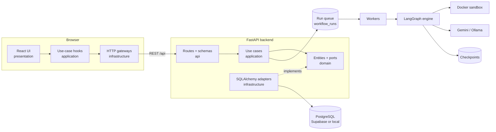
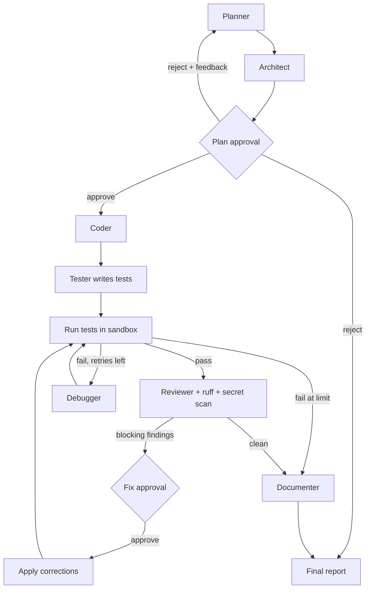

# AgentForge

AgentForge is a multi-agent software engineering workspace. It turns a natural-language
requirement into a plan, an architecture, generated code, **executed** tests, a review and
documentation, using specialised agents orchestrated by a stateful LangGraph workflow.

> **Status: Phases 1–3 complete.** The multi-agent workflow runs end to end: seven agents,
> a LangGraph state machine with human approval, real test execution in an isolated Docker
> sandbox, a bounded debugging loop, review and documentation. See [Roadmap](#roadmap).

## Why

One LLM response rarely produces a working application. AgentForge breaks the job into
stages, each owned by an agent with a narrow responsibility. It validates each stage
against real signals (test-runner output, static analysis) and routes the workflow on
those signals: failing tests go to a bounded debugging loop, not straight to "done".

## Architecture

Both the backend and the frontend use **clean architecture**. Dependencies point inward
only, so business rules have no knowledge of FastAPI, SQLAlchemy, React or `fetch`.



Details: [docs/architecture.md](docs/architecture.md).

**Agent workflow** (the real LangGraph graph):



System-design choices (Postgres job queue, heartbeats, checkpoints, idempotent side effects,
event log + SSE) are explained in [docs/architecture.md](docs/architecture.md#system-design-decisions).

## Tech stack

| Layer | Choice |
| --- | --- |
| Frontend | React 19, Vite 8, TypeScript 6 (strict), Tailwind CSS 4, TanStack Query, React Router 7, lucide-react |
| Backend | Python 3.12, FastAPI, Pydantic 2, SQLAlchemy 2.1, Alembic |
| Database | PostgreSQL via **Supabase** (target) or local Docker (`pgvector/pgvector:pg17`) |
| Auth | Supabase Auth (Google OAuth, PKCE); backend JWT verification with PyJWT + JWKS |
| AI | LangGraph 1.2 (Postgres checkpointer, interrupts), LangChain 1.6; Gemini or local Ollama; LangSmith tracing via env |
| Execution | Docker sandbox: no network, read-only FS, dropped capabilities, non-root, CPU/memory/PID/time limits |

## Quick start

Prerequisites: Python 3.12, Node 24, Docker.

```bash
cp .env.example .env               # set DATABASE_URL (Supabase or local)
docker compose up -d db            # local PostgreSQL (skip if using Supabase)

cd backend
py -3.12 -m venv .venv             # macOS/Linux: python3.12 -m venv .venv
.venv/Scripts/pip install -r requirements-dev.txt   # macOS/Linux: .venv/bin/pip
.venv/Scripts/alembic upgrade head
.venv/Scripts/uvicorn app.main:app --reload --port 8000

docker build -t agentforge-sandbox-python:2 ../docker/sandbox   # test sandbox image (once)

cd ../frontend
npm install
npm run dev                        # http://localhost:5173 (proxies /api to :8000)
```

**Choosing a model** (in `.env`): `LLM_PROVIDER=google` + `LLM_MODEL=gemini-2.5-flash` +
`LLM_API_KEY`, or a free local model with `LLM_PROVIDER=ollama` + `LLM_MODEL=qwen2.5-coder:7b`
(`ollama pull qwen2.5-coder:7b`). `LLM_PROVIDER=scripted` is a clearly labelled demo model
that needs no key: it always builds the same sample project (with one deliberate bug, so the
debugging loop is visible) and is never presented as AI.

**Deploying** (Vercel + Render + Supabase, free tier): see [docs/deployment.md](docs/deployment.md).

To run everything in containers instead: `docker compose up --build` (UI on
http://localhost:5173, API docs on http://localhost:8000/api/docs).

**Using Supabase** means setting `DATABASE_URL` (and `DATABASE_SSL_MODE=require`) to your
project's connection string. Then run `alembic upgrade head` once. The pooler, SSL and
IPv6 notes are in [docs/development.md](docs/development.md#supabase).

## Tests

```bash
cd backend && .venv/Scripts/python -m pytest          # unit + integration (SQLite)
TEST_DATABASE_URL=postgresql+psycopg://agentforge:<POSTGRES_PASSWORD>@127.0.0.1:5432/agentforge_test \
  .venv/Scripts/python -m pytest                      # also runs integration tests on PostgreSQL

cd frontend && npm test && npm run lint && npm run build
```

Opt-in real-model test (`AGENTFORGE_E2E_LLM=ollama:qwen2.5-coder:7b pytest tests/e2e -s`).

Current results (13 Oct 2026, Phase 2): **196 backend tests pass** across SQLite and
PostgreSQL 17. They cover every workflow path through the real LangGraph engine (pass,
fail-then-fix, retry limit, approve, reject with re-plan, reject/cancel, review correction
cycle, crash recovery from a checkpoint, cancellation, unsafe model output) and the run API
(queue, SSE replay, idempotency, quotas, isolation). They also include **5 tests against the
real Docker sandbox** proving its isolation. **57 frontend tests pass.** Lint and type-check
are clean.

**End-to-end validation** (`backend/tests/e2e/test_workflow_validation.py`). Each scenario
runs through the HTTP API, the job queue, a worker, the checkpointer and the **real Docker
sandbox**. Model output is scripted so every run is reproducible:

| Scenario | Real result |
| --- | --- |
| Passes on the first test run | completed, tests 6/6, 0 debug iterations |
| Fails, the debugger fixes it, re-run passes | completed, tests 5/6 → 6/6, 1 debug iteration |
| Keeps failing until the retry limit | partially_completed, 4 runs of 5/6, stopped at 3 iterations |
| Requires human approval of the plan | awaiting_approval → approved → completed, 6/6 |
| ruff finds `shell=True` (tool-verified) | correction approval → fix applied → retested → completed, finding gone |

**Real-model result** (local `qwen2.5-coder:7b`, RTX 5050 laptop GPU): asked for a text-statistics
module. The first sandbox test run failed, the debugging agent fixed it in 2 iterations, and
the final run passed **6/6**. That took 116 s and ~11k tokens. This is one run, not a benchmark;
Phase 6 measures systematically.

## Benchmark: multi-agent vs single agent (Phase 6)

Six fixed tasks (`evals/datasets/`), each solved by **(a)** the full AgentForge workflow
and **(b)** a single-agent baseline: one model call that writes code and tests. Both get
the same prompt, model and sandbox. Each system's own tests only show that its code agrees
with them, so both are graded by **hidden reference tests** written for each task and run
in the Docker sandbox against the system's `app/` code. The reference tests are tested
too: a known-good solution must pass them and known-bad variants must fail
(`tests/e2e/test_benchmark_dataset.py`).

Results with the local `qwen2.5-coder:7b` (RTX 5050 laptop GPU, one run each, 22 Oct 2026;
raw data, generated code and test output in `evals/reports/`):

| Task | Multi-agent, before fixes | Multi-agent, after fixes | Single agent |
| --- | --- | --- | --- |
| Items REST API | **11/11 solved** | **11/11 solved** | 8/11 |
| Registration input validation | 6/35¹ | 12/35 | 12/35 |
| In-memory todo store (CRUD) | 10/14 | 13/14 | 13/14 |
| Fix a planted off-by-one bug | **8/8 solved** | **8/8 solved** | **8/8 solved** |
| Write tests for an existing function | 7/11 | **11/11 solved** | 0/1 (code did not import) |
| Add API-key auth | not finished² | 0/1 (crashes at import) | 1/9 |

| After fixes | Multi-agent | Single agent |
| --- | --- | --- |
| Tasks solved (all reference tests pass) | **3/6** | 1/6 |
| Reference tests passed (mean per task) | **71%** | 52% |
| Median time per task | 143 s | 19 s |
| Tokens (all 6 tasks) | 221k | 7k |

What the benchmark found, and what changed because of it:

- **Agents lost the details of the request.** Only the planner saw the user's request; the
  coder worked from the plan's summary, so it dropped a `done` field and rewrote a function
  it was told to keep. Every agent after the planner now receives the original request as
  the source of truth. "Write tests" went from 7/11 to solved, CRUD from 10/14 to 13/14.
- **A looping model could run for an hour.** One call generated 164k tokens in 56 minutes.
  Answers are now capped (`LLM_MAX_OUTPUT_TOKENS`) and every agent call has a time budget.
- **A system's own tests are a weak signal.** Multi-agent's own suite was green on only 2 of
  6 tasks, even where its code passed every reference test; the debugger sometimes spent its
  rounds on wrong tests rather than wrong code.

Honest reading: with a 7B local model the workflow solves more tasks (3 vs 1), but it costs
about 30× the tokens and 7× the time, and the model, not the workflow, is the main limit
(the remaining failures are spec violations such as reading an environment variable at
import time). The workflow code did not change between the last three runs, which solved
**3, 3 and 2** of 6 tasks for the multi-agent workflow and **1, 1 and 1** for the baseline
(`evals/reports/run2-*`, `phase4-regression-*`, `phase5-regression-*`). The same task can pass
in one run and fail in the next (temperature 0.2), so a single run's differences of a task or
two are noise; the consistent gap across runs is the signal. A stronger-model run is planned.

**Latest run, 7 tasks** (`evals/reports/run5-qwen7b-memory*`, after adding the PostgreSQL task,
the shared run memory and the debugger guards): the multi-agent workflow solved **4/7**
(REST API, planted bug, write tests, and the new **database schema task, 14/14**, including the
tests that check the database itself enforces the rules); the single agent solved **1/7**
(it could not produce a working schema at all). Add-auth stays unsolved by both with this model.

¹ Graded with an earlier version of the reference tests that matched error messages
case-sensitively; fixed before the "after" run. ² The "before" run was stopped after 9 of 12
attempts while the baseline was stuck in the runaway loop described above.

Run it: `cd backend && .venv/Scripts/python ../evals/scripts/run_benchmark.py` (results also
appear on the **Evaluations** page).

## Knowledge base (RAG, Phase 4)

Upload a project's own documents (coding standards, API guidelines, reference code) on the
**Knowledge Base** page. The planner, architect and coder then retrieve the relevant passages
during every run, with file and line citations, fenced as untrusted reference material.

```
upload -> validate -> redact secret-looking lines -> structure-aware chunks (with line ranges)
       -> embeddings (hash | Ollama nomic-embed-text | Gemini) -> pgvector
query  -> dense (cosine) + sparse (BM25) -> reciprocal rank fusion -> rerank (lexical | LLM)
       -> query-level relevance gate -> top k -> agents
```

**Measured, not assumed.** A labelled set of 36 queries over a 9-document sample corpus
(`evals/datasets/retrieval/`: 14 keyword, 15 paraphrased, 3 code, 4 with no relevant document)
compares every configuration. `evals/scripts/run_retrieval_eval.py`, 22 Oct 2026, k = 5:

| Configuration | hash embedder: hit@1 / MRR | nomic-embed-text: hit@1 / MRR | Off-topic queries rejected |
| --- | --- | --- | --- |
| dense only | 0.62 / 0.78 | **0.94 / 0.97** | 0% |
| sparse only (BM25) | 0.81 / 0.88 | 0.81 / 0.88 | 50% |
| hybrid (RRF) | 0.84 / 0.91 | 0.88 / 0.93 | 0% |
| **hybrid + lexical rerank (default)** | **0.88 / 0.91** | 0.84 / 0.89 | **75%** |
| hybrid + LLM rerank (qwen2.5-coder 7B) | not run | 0.88 / 0.89 | **100%** |

What the evaluation changed:

- **The relevance gate moved from per-chunk to per-query.** The first version dropped every
  chunk with little word overlap. It rejected all off-topic queries but also half of the
  correct answers to paraphrased questions (MRR 0.72). Gating once per query keeps those
  answers.
- **Without any gate, every query gets context**, including "sourdough bread recipe".
  Irrelevant passages are what distract small models most, so the default keeps a gate.
- **With a strong embedder, dense search alone ranks best**, but it never says "nothing
  relevant". The default trades a little ranking quality (0.89 vs 0.97 MRR) for keeping
  off-topic text out of prompts; `RAG_RERANKER=llm` rejects all off-topic queries at the
  cost of one model call per retrieval.

Honest limits: 32 answerable queries means one query moves a score by 0.03, so differences
below about 0.05 are noise. The gate threshold (0.15) was chosen on this same set from four
coarse values, so it is tuned rather than held out. Whether retrieval makes the *generated
code* better has not been measured yet; that needs benchmark tasks that depend on project
documents.

## Shared run memory and a debugger that verifies its own fixes

A real run showed the failure mode: the debugger edited `app/repository.py` three times with
the same diagnosis while every failure was raised in `tests/test_repository.py` (the tests
called a generator directly). Hints were not enough for a 7B model, so AgentForge now
**measures and enforces** instead of only advising:

- **Shared run memory:** every agent appends assumptions, decisions, notes and hypotheses;
  every later agent reads them. AgentForge adds **facts** from each real test run (what
  failed and at which `file:line`, with the code on that line) and a **verdict** after every
  debugging attempt, computed from the re-test: confirmed, partly, refuted or regressed.
  The run page's **Memory** tab shows it live, with measured entries marked.
- **Failure locations:** the debugger gets the failing lines extracted from the real
  traceback, and files with line numbers (a copied-back number prefix is stripped).
- **Regressions are undone:** a fix that makes fewer tests pass, or breaks test collection,
  is marked `regressed` and reverted before the next attempt, so a bad fix never becomes
  the starting point (or the delivered code).
- **Repeats are blocked:** a diagnosis that repeats an attempt already measured as not
  working, on the same files, is rejected. The single retry may only change the files where
  the failures are reported and that were not tried yet.

Replaying that stuck run with the new debugger (same files, same failing report, real model
and sandbox): the verdicts were accurate, one regressing fix was caught and reverted, and a
repeated wrong edit was blocked, but `qwen2.5-coder:7b` still never proposed the fix in the
test file. The system now stops a weak model from making things worse and records exactly
why it failed; finding the fix still takes a stronger model.

## Real databases (PostgreSQL)

Set a project's **Database** to `PostgreSQL` and the workflow gains a **Database schema**
step, and every test run gets a real database:

```
plan → architect → [approve] → Database schema agent → code → tests → run tests …
                               writes db/migrations/0001_initial.sql

each test run:  private Docker network (no internet)
                ├─ throwaway PostgreSQL 17 (tmpfs, resource limits, deleted afterwards)
                └─ sandbox: apply migrations in order → read the schema back → pytest
```

- The schema agent designs tables with primary and foreign keys, NOT NULL, UNIQUE, CHECK
  constraints and indexes, as plain SQL migrations. The coder and tester are told exactly
  what the sandbox provides (`DATABASE_URL`, migrations only, clean data with `TRUNCATE`).
- A run only counts as verified when **every migration applied and every test passed**.
  A failed migration's SQL error goes to the debugger, which may fix the SQL; the coder
  may not rewrite the schema.
- The run page's **Database** tab shows each migration's result and the schema **read
  back from the real database** (columns, keys, constraints, indexes), not the model's
  description of it.
- Safety: the code connects as a **non-superuser** role with a random password (so SQL
  cannot run shell commands via `COPY … PROGRAM`), the network has no internet, a stuck
  migration is killed by the run's time limit, and leftovers from a crash are removed at
  the next start.
- The benchmark has a seventh task (`db_schema`) whose hidden tests check both the
  Python API and that **the database itself enforces the rules** (raw SQL that breaks a
  rule must fail). Its reference tests are proven against a known-good solution and two
  known-bad schemas (rule only in Python, missing cascade).

## What is implemented

- **Sign-in with Google or email/password** (with email confirmation and password reset) via Supabase Auth. The backend verifies every request's JWT against the
  project's public keys, and each user sees only their own projects (enforced server-side).
- Project CRUD (create, list/search/paginate, view, edit, delete with cascade) persisted
  in PostgreSQL (Supabase).
- The full relational schema for upcoming workflow data (runs, agent executions, events,
  artifacts, test results, review findings, approvals), managed by Alembic.
- A dashboard computed only from persisted rows. Rates show "—" when there is nothing to
  compute them from; a new database shows onboarding, never sample numbers.
- `GET /api/system/status`, which reports what is configured and what is not yet built.
  **Run Project** is enabled only when the backend reports the workflow engine and LLM
  as ready.
- Structured error responses, request-size limits (including chunked bodies), CORS
  allowlist, and secret-free configuration reporting.
- A dark developer-workspace UI: collapsible sidebar, breadcrumbs, live backend status,
  responsive layouts, and loading, empty and error states.
- **Multi-agent workflow:** Planner, Architect, Coder, Tester, Debugger, Reviewer and
  Documenter agents with structured (schema-validated) outputs, orchestrated by LangGraph.
- **Real verification:** tests run with pytest inside the sandbox; counts come from JUnit XML.
  Failures route to a bounded debugging loop (default 3). Static analysis (ruff security rules,
  secret scanning) is labelled as tool-verified, separately from LLM review opinions.
- **Human-in-the-loop:** approval before code generation (reject with feedback to re-plan) and
  before applying fixes for blocking findings, using LangGraph interrupts.
- **Runs as jobs:** Postgres-backed queue, background workers, heartbeats, crash recovery,
  resume from checkpoint, cancellation, idempotency keys, per-user quotas.
- **Knowledge base (RAG):** per-project documents, secret redaction, hybrid retrieval with
  reranking and a relevance gate, a "test retrieval" panel that shows every stage's score, and
  a retrieval evaluation that runs in CI.
- **Execution history:** every run with its complete persisted event log, filterable by
  project and status.
- **Evaluations:** benchmark of the multi-agent workflow against a single-agent baseline.
- **Interactive workflow graph:** the real LangGraph topology (with its debug, correction and
  re-plan loops), live step states, the path a run took, and every attempt of a step on click.
- **Code workspace:** review findings shown on their lines, files revised by the debugger
  marked, and one click from a finding or failing test to the exact `file:line`.
- **Agent Activity:** which agent is working on which run right now, across all runs.
- **Live run page:** streamed events (SSE), pipeline view, agent timeline, generated files
  with syntax highlighting, test attempts and failures, filterable review findings, final
  report split into *verified by tools* and *generated by the model*, zip download.

## Roadmap

| Phase | Scope | State |
| --- | --- | --- |
| 1 | Foundation: shell, persistence, schema, dashboard, auth | **Done** |
| 2 | Agents, LangGraph workflow, Docker sandbox, queue + workers, SSE, run UI | **Done** |
| 3 | Debugging loop, review + static analysis, approvals, final report, end-to-end validation against the real sandbox | **Done** |
| 4 | RAG knowledge base (pgvector, hybrid retrieval, reranking, retrieval eval), execution history | **Done** |
| 5 | Interactive workflow graph, code workspace, testing dashboard, agent activity | **Done** |
| 6 | Benchmark vs single-agent baseline, evaluation dashboard | **Done** (stronger-model run planned) |

## Known limitations

- Only Python projects can be executed (the sandbox image is Python-only and offline, with a
  fixed package set: pytest, fastapi, httpx, pydantic, sqlalchemy, psycopg). The only
  database server available is PostgreSQL 17, per run and throwaway.
- The sandbox needs Docker. On hosts without it (e.g. Render free tier) runs still plan, code,
  review and document, but tests are reported as **not executed**.
- Small local models make more mistakes than hosted ones; results depend on the model.
- The Google sign-in round trip has to be checked manually in a browser.

See [docs/security.md](docs/security.md) for the security model and its current gaps.
