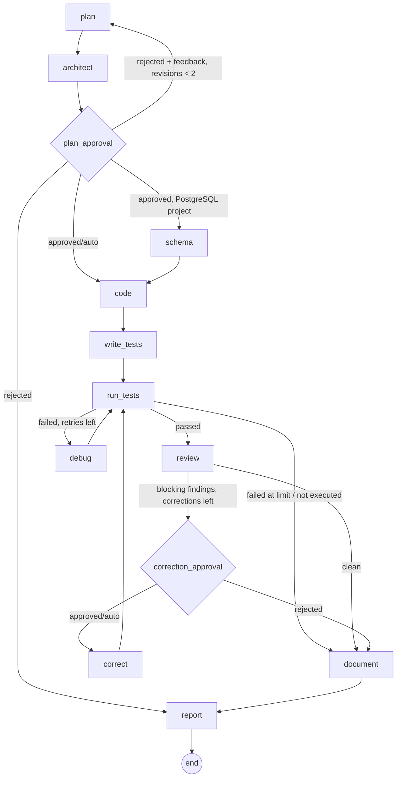

# Architecture

## Principles

1. **Dependencies point inward.** Outer layers (web framework, ORM, React, HTTP) depend on
   inner layers (use cases, domain), never the reverse.
2. **Ports at the boundary.** Inner layers declare what they need as interfaces
   (`Protocol` in Python, `interface` in TypeScript). Outer layers implement them.
3. **One composition root per app.** Concrete classes are chosen in exactly one place,
   so tests swap them for fakes without monkey-patching.
4. **Verified over generated.** State such as test results comes from tools. The LLM's
   claims are never trusted as evidence.

## Backend (`backend/app`)

```
domain/           Entities, invariants, enums, ports. Pure Python: no FastAPI or SQLAlchemy.
  project.py        Project aggregate; validates and normalises its own fields
  ports.py          ProjectRepository protocol
  enums.py          Run/agent/finding/approval status vocabularies
  errors.py         EntityNotFoundError, InvariantViolationError
application/      Use cases. Depend on domain only.
  projects.py       ProjectService + command objects
  dashboard.py      Metric rules (null when undefined) + DashboardReadModel port
  system.py         Honest component status + DatabaseProbe port
infrastructure/   Adapters for the outside world.
  config.py         Settings from env (pydantic-settings); secrets as SecretStr
  persistence/
    database.py     Engine construction (PostgreSQL/Supabase/SQLite), DB probe
    orm/            SQLAlchemy models (suffix *Model), never leaked past this package
    project_repository.py, dashboard_read_model.py
api/              Presentation (FastAPI).
  dependencies.py   Composition root: wires services to adapters per request
  schemas/          Request/response models + mapping from application types
  routes/           Thin handlers: parse → call use case → serialise
  errors.py         Maps domain errors and framework errors to {"error": {...}}
  middleware.py     Request size limit (Content-Length and streamed bodies)
main.py           create_app(settings): builds engine, middleware, routers
```

Request flow for `PATCH /api/projects/{id}`:

```
route ──▶ ProjectUpdate (pydantic: shape and limits)
      ──▶ ProjectService.update ──▶ repository.get ──▶ Project.revise (domain invariants, atomic)
                                ──▶ repository.save ──▶ SQL UPDATE
      ◀── ProjectRead.from_overview
```

Validation happens twice on purpose. Pydantic gives clients field-level 422 errors, and
the domain entity enforces the same rules whatever the caller (future agents and CLI tools
included). Both read the limits from `app/domain/project.py`.

**Read models.** The dashboard needs aggregates across tables. Rather than loading
entities, `DashboardReadModel` returns a raw `DashboardSnapshot`, and
`application/dashboard.build_metrics` applies the rules (completion rate counts only
terminal runs; pass rate counts only executed suites; null when the denominator is zero).
Those rules are unit-tested without a database.

**Schema.** The initial migration (`migrations/versions/0001_initial_schema.py`) already
contains the workflow tables: `workflow_runs`, `agent_executions`, `workflow_events`
(append-only, indexed by `(run_id, id)` for SSE replay), `artifacts` (path, sha256 and size,
with content kept in workspace storage), `test_results` (an `executed` flag separates
generated tests from run tests, and output is a bounded excerpt plus a log path),
`review_findings` (`source` = `tool` | `llm`) and `approval_requests`. Statuses are stored as
VARCHAR with application-side validation, so adding a status needs no enum-type migration.
All foreign keys to a run cascade on delete.

## Frontend (`frontend/src`)

```
domain/           Types and rules: Project, validateProjectDraft, RUN_STATUS_META, canStartWorkflow
application/      Ports (ProjectGateway, ...), GatewaysProvider, use-case hooks (TanStack Query), AppError
infrastructure/   http-client (fetch → AppError), HTTP gateways (DTO ↔ domain mapping)
presentation/     ui/ primitives, feature components, layouts, pages
app/              Composition root: routes, providers, main.tsx (only file that picks HTTP gateways)
styles/           Tailwind theme tokens (semantic colour names only)
```

- Presentation never imports from `infrastructure/`. Pages call hooks such as
  `useCreateProject()`, which call a `ProjectGateway` obtained from context.
- Gateways translate wire formats (snake_case, ISO strings, backend field names in
  validation errors) into domain types, so the UI only ever sees domain names.
- Tests render the **real route tree** with fake gateways (`src/test/render.tsx`), which
  exercises routing, providers and pages together without mocking `fetch`.
- The workflow graph's topology (`domain/run.WORKFLOW_EDGES`) mirrors the LangGraph wiring;
  a test checks every step is reachable and that the graph has exactly the backend's three
  bounded loops. React Flow is lazy-loaded, so its chunk downloads only with a run page; the
  graph's accessible twin is a plain step list (the only view on phones).
- Charts (evaluation comparison, tests per run) are plain HTML/CSS bars with per-bar labels
  and a table or list view; no chart library.

## Workflow layer

```
application/workflow/   framework-free core
  ports.py        Sandbox, Retriever, RunJournal (all side effects of a run)
  state.py        typed WorkflowState + reducers (files merge by path, usage accumulates)
  steps.py        one method per graph node; uses only ports
  routing.py      conditional edges as pure functions; every loop bounded by a counter
  secret_scanner.py   deterministic secret detection
application/agents/     prompts.py (with untrusted-content fencing) and schemas.py (structured outputs)
application/runs/       RunService (quotas, idempotency, approvals, cancel, resume), RunProcessor
infrastructure/
  workflow/langgraph_engine.py   graph topology + interrupt()/Command(resume=...)
  workflow/checkpointer.py       PostgresSaver (Supabase/local) or in-memory for SQLite tests
  llm/                           Gemini / Ollama via LangChain, scripted demo model
  sandbox/docker_sandbox.py      isolated pytest + ruff execution
  persistence/run_repository.py  job queue (compare-and-set claims), read models
  persistence/run_journal.py     idempotent keyed upserts for every side effect
  worker/background.py           worker pool, heartbeats, stale-run recovery
app/bootstrap.py                 composition root (the only place concretes are chosen)
```



### System design decisions

| Concern | Decision | Why |
| --- | --- | --- |
| Long-running work | Runs are rows in a **Postgres-backed job queue**; worker threads claim with compare-and-set (`UPDATE ... WHERE status='queued'`) | No extra infrastructure (Redis, SQS); exactly-one-claim semantics; works on Supabase |
| Liveness | Workers **heartbeat** every 15 s; a recovery loop re-queues runs whose heartbeat is stale | A crashed worker never strands a run |
| Durability | LangGraph **checkpoints** after every node (PostgresSaver) | Crash recovery and "Resume from checkpoint" skip completed steps |
| Exactly-once effects | Every side effect is a **keyed upsert** (run+node+attempt, run+path, run+attempt, run+kind+cycle) | LangGraph re-executes an interrupted node from its start; repeats are harmless |
| Live UI | **Append-only event log** + SSE with `Last-Event-ID` | Reconnects resume exactly; any number of API instances can serve streams |
| Human in the loop | `interrupt()` pauses the graph; the decision is stored, the run re-queued with a resume payload | Pausing costs no worker; decisions use compare-and-set (no double decisions) |
| Bounded loops | debug iterations, review corrections and plan revisions are capped counters | The graph always terminates |
| Trust | Test results only from the runner's JUnit XML; tool findings labelled separately from LLM findings | Model output is never treated as evidence |
| Abuse/cost control | Per-user active-run quota, hourly rate limit, idempotency keys on run creation | Retries and double clicks cannot multiply LLM spend |
| Multi-tenancy | Ownership enforced in repository queries; Supabase RLS denies the public Data API | Defence in depth |
| Scaling path | Workers can run in separate processes (same queue); artifacts move to object storage; events to a broker | Each is a new adapter behind an existing port |

## Databases for generated projects

| Concern | Decision | Why |
| --- | --- | --- |
| Where the database comes from | One throwaway `postgres:17-alpine` per test run, on its own `--internal` Docker network shared only with that run's sandbox | Real behaviour (constraints, transactions, SQL dialect) without a shared server or internet access |
| How the schema is created | Plain SQL files in `db/migrations/`, applied in name order by a trusted runner before pytest | Migrations are reviewable artifacts; the app and tests never create tables, so the schema under test is the one the agent designed |
| Trust | Results (migrations, schema) are read from the database by our runner, and rebuilt field by field from its report | The UI shows what PostgreSQL actually has, not what the model claims |
| Success | `TestReport.succeeded` requires every migration to apply | Passing tests on a broken schema is not success |
| Ownership | The database agent writes migrations; the coder cannot; the debugger may fix them | Keeps the schema one agent's responsibility while allowing repair |

## Knowledge base and retrieval (Phase 4)

```
upload -> validate (name, type, size, UTF-8) -> redact secret-looking lines -> chunk
       -> embed (Embedder port: hash | ollama | google) -> knowledge_documents + knowledge_chunks
          (pgvector `vector` on PostgreSQL, JSON on SQLite; one transaction per document)

query  -> dense top 20 (cosine; pgvector `<=>` in SQL)  ┐
       -> sparse top 20 (BM25 over the project's chunks)┴-> reciprocal rank fusion -> pool of 20
       -> Reranker port (lexical | llm) -> query-level gate (best score >= RAG_MIN_SCORE)
       -> rank by 0.5 * rerank + 0.5 * normalised fusion -> drop overlapping/zero-evidence chunks -> top k
       -> workflow Retriever port -> fenced, cited context for planner, architect and coder
```

| Concern | Decision | Why |
| --- | --- | --- |
| Chunking | Structure-aware: markdown sections (heading path kept), top-level Python definitions with decorators, text paragraphs; ~800 characters with ~150 overlap; exact line ranges | Citations (`file lines a-b (Section)`) and chunks that start where meaning starts |
| What is embedded | The chunk text prefixed with its file name and heading | A chunk that never repeats its subject is still found by it |
| Hybrid retrieval | Dense and BM25 fused by reciprocal rank fusion | Fusion beat either retriever alone in the evaluation; ranks combine without calibrating scores |
| Gate | Per query, not per chunk | A per-chunk word-overlap cutoff discarded half of the correct answers to paraphrased questions (measured) |
| Embedder changes | Each chunk records its embedder; searches never compare vectors across embedders; documents show `stale` and can be re-indexed | Vectors from different models are meaningless to compare |
| Storage | `vector` column without fixed dimension, exact search | Different embedders can coexist; per-project knowledge bases are small. An HNSW index per dimension is the scaling path |
| Quality guard | `tests/unit/test_retrieval_eval.py` runs the labelled evaluation set on every test run | A change that makes retrieval worse fails CI |

## Evaluation layer (Phase 6)

```
evals/datasets/tasks.json + tasks/<id>/prompt.md + hidden test_reference_*.py
        |  infrastructure/evaluation/task_loader.py
        v
BenchmarkRunner (application/evaluation/benchmark.py)
  for each task x system:  system.solve(task) -> Attempt (files, own test tally, tokens, debug iterations)
                           grade: reference tests + the system's app/ code, in the Docker sandbox
                           findings: secret scanner + ruff on the final files (same tools for both)
        |  EvaluationRepository (keyed upsert)          |  JSON report + saved attempts
        v                                                v
  evaluation_runs table -> GET /api/evaluations -> Evaluations page    evals/reports/<id>.json, <id>/<task>/<system>/
```

| Concern | Decision | Why |
| --- | --- | --- |
| What is compared | `MultiAgentWorkflow` (the full LangGraph graph, approvals off) vs `SingleAgentBaseline` (one model call writing code and tests), both behind the `CodingSystem` port, same prompt text, same sandbox, same model | A fair, swappable comparison; a third system is one more adapter |
| Correctness measure | Hidden **reference tests** written by people, not each system's own tests | A system's own tests only show that its code agrees with them |
| Trust in the instrument | Each task ships a known-good solution; a Docker test proves solutions pass and known-bad variants fail | A wrong reference test would silently mis-grade every run |
| Failure handling | A crashed attempt is recorded as unsolved (graded against no code); a missing sandbox stops the run | One bad model answer cannot abort a benchmark, and missing grades cannot inflate averages |
| Aggregates | Computed from stored rows by `domain/evaluation.summarize`; undefined values are `null` | Same "never fabricate, never show null as 0" rule as the dashboard |
| Composition | `bootstrap.build_benchmark` wires the real model, sandbox, in-memory checkpointer and repository; the command in `evals/scripts/` only parses arguments | Concrete classes are still chosen in one place |
